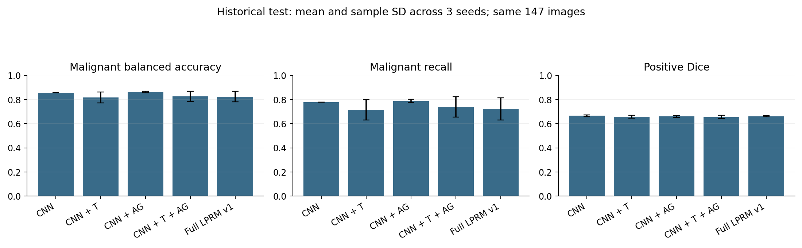
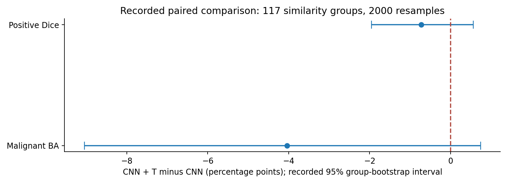
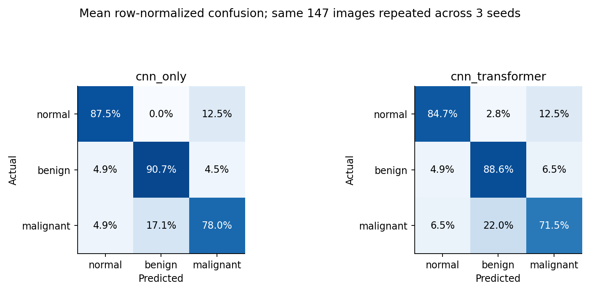
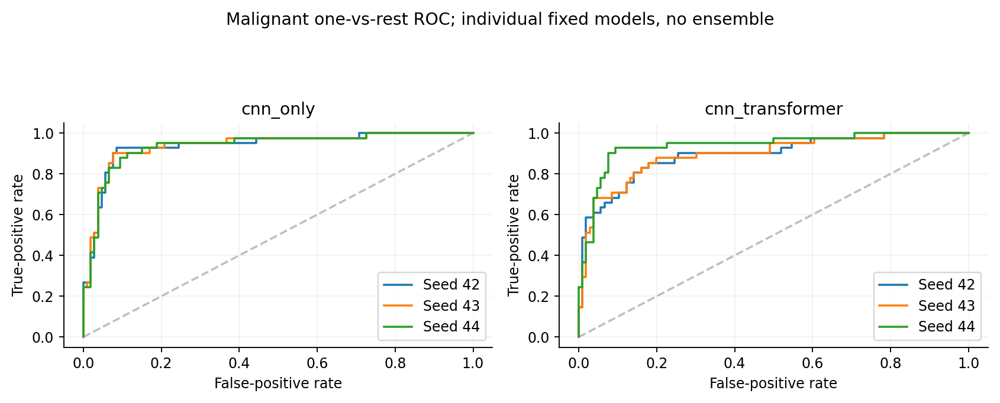
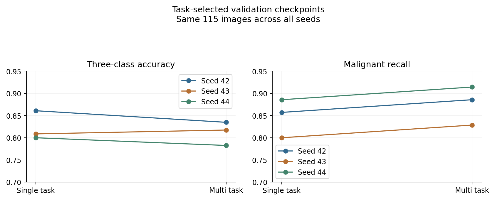
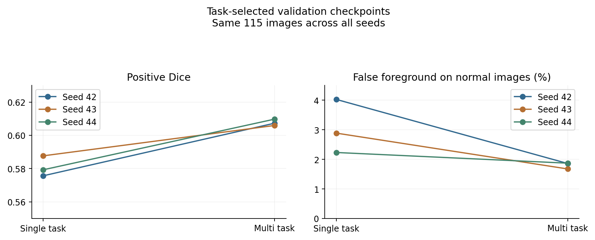

# Lightweight Multi-Task Breast Ultrasound Analysis

Advisor review package for a master's thesis on three-class classification and binary lesion segmentation in BUSI ultrasound images. The investigated components are MobileNetV2, a spatial Transformer, attention-gated decoding, class-cost weighting, task balancing, and a learnable prediction refinement module (LPRM).

[راهنمای فارسی](README_FA.md) · [Execution and dependencies](docs/RUNNING.md) · [Scientific scope](docs/CLAIMS_AND_LIMITATIONS.md) · [Data and split](docs/DATA.md) · [Artifact provenance](docs/result_provenance.csv)

## Start the review here

1. Read the **two experimental protocols** below before comparing their scores.
2. Inspect [historical test results](results/tables/historical_test_summary.csv), [core classification results](results/tables/core_classification_comparison.csv), and [core segmentation results](results/tables/core_segmentation_comparison.csv).
3. Open the linked plots below. Their numerical source files are retained unchanged under `results/archives/`.
4. Run the offline numerical checks and regenerate the figures:

```bash
python -m pip install -r requirements-review.txt
python tools/rebuild_review.py
```

This writes to `review_generated/`. It uses archived class probabilities, packed hard masks and reference masks, without raw images, model weights, TensorFlow, training, or new inference. The packaged [audit](results/generated/review_audit.json) contains **288/288 passing numerical comparisons**. This verifies the exported numerical tables, not a replay of the original training process.

## Experimental protocols

| Study | Initial state and training | Evaluation |
|---|---|---|
| Historical component study | Shared BUSI-trained starting weights; CNN frozen; Transformer, gate and LPRM variants; class-cost/task-weight settings recorded per run | Historical fixed test, 147 images; seeds 42, 43, 44 |
| Controlled single vs multi task | ImageNet CNN frozen; Transformer/heads freshly seeded and independently cloned; unit class/task weights; LPRM disabled; 30 epochs | Exploratory validation only, 115 images; separate classification and segmentation checkpoint selection |
| Augmentation and cost-loss follow-ups | Common BUSI-trained warm start; paired controls; recorded configurations | Exploratory validation only |

These protocols have different initialization and architectural details. Their scores must not be pooled into one ablation or described as the same model evaluated twice. The historical test had been inspected before later development; this history is disclosed.

## Findings to inspect

- Historical test: the primary CNN+Transformer minus CNN comparison gives malignant balanced accuracy **−4.04 percentage points**, recorded 95% group-bootstrap interval **[−9.05, +0.74]**. Positive Dice difference is **−0.73 pp [−1.95, +0.56]**. Both intervals include zero.
- Controlled validation: mean malignant recall increases from **84.76% to 87.62%** while mean three-class accuracy decreases from **82.32% to 81.16%**. At the separately segmentation-selected checkpoints, positive Dice increases from **0.5809 to 0.6076**.
- These classification and segmentation optima can be different checkpoints. They are not simultaneous performance of one selected set of weights.
- One core MTL architecture has 3,278,208 parameters, compared with 6,004,032 for the sum of the two independent single-task architectures. The 45.40% reduction concerns **one MTL instance**; retaining and running two separately selected MTL checkpoints requires accounting for both instances.
- Class-cost ratio 1:1:2 and LPRM v1 did not show consistent benefit for the primary objectives in the evaluated settings. Raw contrary results are retained.

## Plots








[Classification training curves](results/generated/figures/training_classification.png) · [Segmentation validation curves](results/generated/figures/training_segmentation.png)

[Normal example with segmentation false foreground](results/figures/gradcam_normal66.png) · [Malignant example classified as benign](results/figures/gradcam_malignant61.png)

Grad-CAM maps are native 7×7 and normalized independently for display. Red denotes relatively strong positive class-score support within a map; it is not a lesion probability or evidence of localization accuracy. The displayed cases are illustrative archived examples, not a population localization evaluation.

## Code and data availability

- `notebooks/`: data preparation, documented paper-settings reconstruction, component study, controlled ST/MTL study, augmentation/cost follow-ups, and Grad-CAM.
- `src/`: original training, component, final-evaluation and Grad-CAM Python files.
- `exploratory/`: LPRM v2 continuation and targeted fine-tuning; these do not redefine the final LPRM v1 comparison.
- `legacy/`: earlier interactive data-preparation notebook, retained for provenance.
- `config/`: recorded protocols and serialized model architecture. `architecture_spec.json` describes the initial candidate; its construction-time status is not a training result.
- `data/split_manifest.csv`: fixed membership, 761 images, 582 similarity groups. The raw BUSI images and model weights are **external dependencies**.
- `data/required_checkpoints.json`: 28 recorded checkpoint/initial-weight entries, 27 unique hashes. `notebooks/Export_Advisor_Checkpoints.ipynb` copies and verifies these files from the owner's Drive for a separate checkpoint handoff.
- `docs/source_inventory.csv`: original and packaged hashes. Notebook cell sources are unchanged; cached outputs and execution counters are cleared. Real experiment outputs live in the separate archived exports.

Training notebooks are Colab entry points with recorded Drive dependencies; they are not all-from-scratch, dependency-free demos. See [RUNNING.md](docs/RUNNING.md) before using “Run all”. This packaging run did not train or run a neural network. Missing weights, the original Drive folder structure, and the absence of a complete soft-mask archive limit full reproduction.

The original closure export remains **REVIEW_REQUIRED** with two recorded metric differences. Its raw status is preserved in [closure_summary.json](results/tables/closure_summary.json); [the two flags](results/generated/original_closure_flags.csv) concern historical normal foreground area and are discussed in the scope notes.

## References and permissions

- BUSI: Al-Dhabyani et al., *Data in Brief* 28 (2020), 104863. https://doi.org/10.1016/j.dib.2019.104863
- BUSI errata: Pawłowska et al., *Data in Brief* 48 (2023), 109247. https://doi.org/10.1016/j.dib.2023.109247
- Base paper: Islam et al., *Machine Learning with Applications* 16 (2024), 100555. https://doi.org/10.1016/j.mlwa.2024.100555
- MobileNetV2: https://arxiv.org/abs/1801.04381
- Transformer: https://arxiv.org/abs/1706.03762
- U-Net: https://arxiv.org/abs/1505.04597
- Attention U-Net: https://arxiv.org/abs/1804.03999
- Grad-CAM: https://arxiv.org/abs/1610.02391

The paper-settings notebook is a documented reconstruction with explicitly inferred choices, not the authors' original code or an exact replication. No new open-source license is assigned by this packaging operation. Dataset and third-party permissions remain with their respective owners. This package is prepared for advisor review; publication and repository access are decisions for the project owner.
